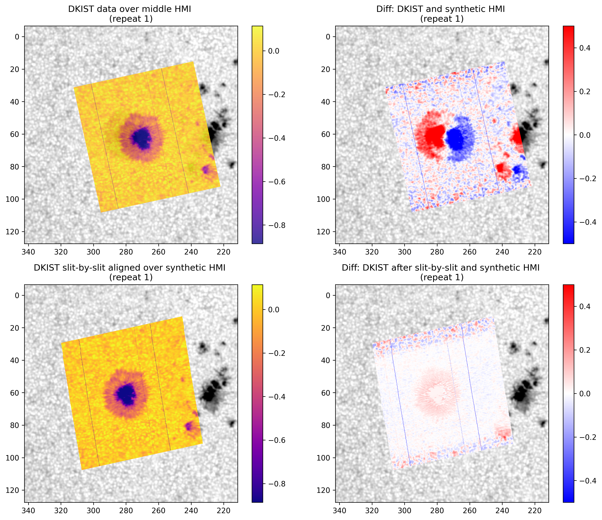
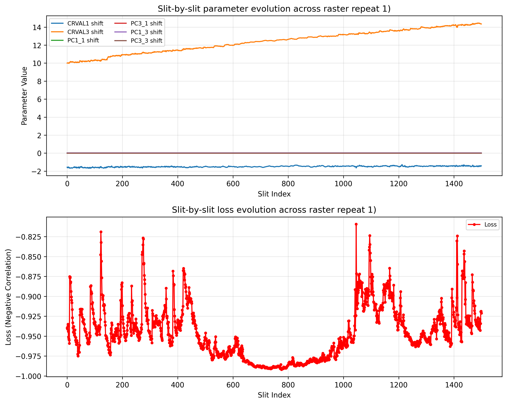

# DKIST visp-alignment

## Concept
DKIST's ViSP instrument offers some of the highest spatial resolution spectropolarimetric observations, but sometimes comes with pointing errors up to 30 arcseconds. To align ViSP data, we take advantage of the stable coordinates and data from the Helioseismic and Magnetic Imager (HMI) on the Solar Dynamics Observatory (SDO) to correct for these pointing errors. The alignment is done by interpolating HMI data to the scale of DKIST data and using a loss function to find the best shift in DKIST's spatial coordinates to align with HMI data.

## Overview of the alignment process 
1. Load in the DKIST data and use `fido.search()` to download all the HMI data that falls +/- 1 min cotemporal to the DKIST data.
2. Construct DKIST's spatial coordinates using the header keywords `CRVAL1/3`, `CRPIX1/3`, `CDELT1/3`, and `PCi_j`. 
3. Interpolate the cotemporal HMI data to the scale of the DKIST data. 
4. Calculate the loss between DKIST and interpolated HMI data to optimize for the best `CRVAL1/3` and `PCi_j`.
5. Reconstruct the DKIST coordinates with the calculated shifts. 

## Running Requirements
Here is the list of all the tools/python libraries required to run `visp_alignment.py`

```
from pathlib import Path
import numpy as np
import astropy.io.fits as fits
from astropy.time import Time, TimeDelta
import astropy.units as u
import matplotlib.pyplot as plt
from sunpy.net import Fido, attrs as a
from sunpy import map as map
import dkist
import os
from scipy import interpolate as interp
import scipy.optimize as opt
import bisect
from itertools import chain
```

## Sample Code Output
The code outputs 2 images. Here what they should look like: 

These graphs plots the DKIST data on top of HMI. The two graphs on the top show the misaligned data, whereas the bottom two graphs show the aligned data. 

The graph on the top here shows how the parameters used to buid the DKIST coordinates changed as move down slit by slit. The graph on the bottom shows how the loss function changes as we move doing slit by slit. 

